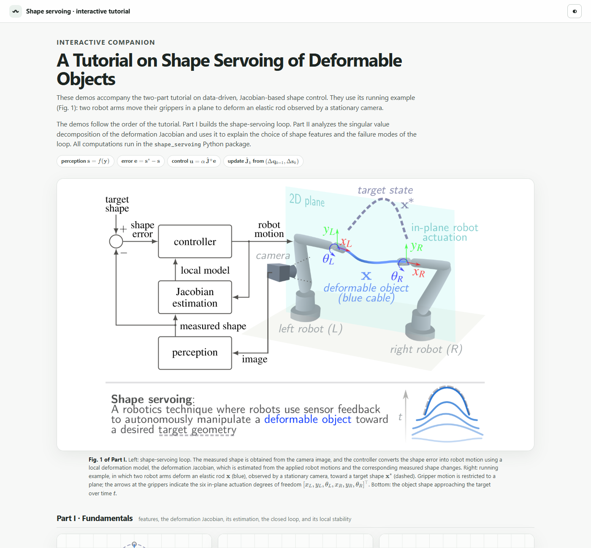
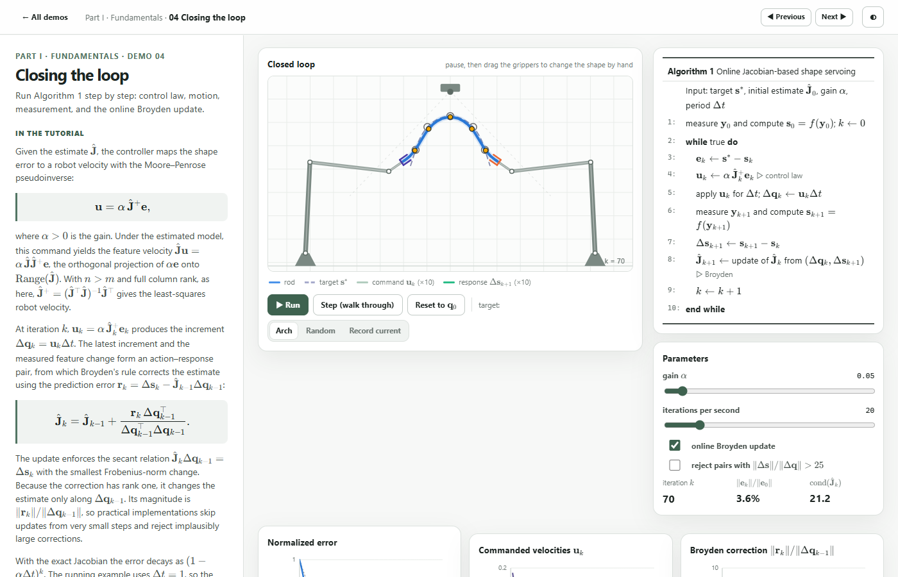

# Shape servoing of deformable objects: tutorial code and interactive demos

Code and interactive demos for the tutorial *Shape Servoing of Deformable Objects: A Tutorial*. The demos follow the article in two levels: level 1, fundamentals (Sections II-IV, Demos 01-07), and level 2, advanced concepts (Sections V-VII and Appendix E, Demos 08-12). They implement the running example of the tutorial, an elastic rod held by two robot grippers and observed by a camera, and reproduce the numerical results of the article and its supplementary material.

**Interactive demos: <https://shape-servoing.github.io/tutorial/>**



## Contents

- **`docs/`**: twelve interactive demos, in the order of the tutorial, in which the object, the Jacobian estimate, and the controller can be manipulated. All computations run in the browser, so no installation is needed.
- **`shape_servoing/`**: a Python package (numpy only) that implements the tutorial with its notation: the simulated rod, the feature maps, the deformation Jacobian and its estimation, the control law and Algorithm 1, the singular value and stability analysis, the failure modes, and compact 3-D rod and as-rigid-as-possible (ARAP) models.
- **`examples/algorithm1.py`**: Algorithm 1 on the running example, without the demos.
- `demos/`, `tests/`, `tools/`: the Python reference of the demo pages, the tests, and the build of the pages; see [TESTS.md](TESTS.md) and [DEVELOPMENT.md](DEVELOPMENT.md).

## Opening the demos

- **Online:** <https://shape-servoing.github.io/tutorial/>
- **On your computer:** run `python run.py` (Python 3.9 or newer, standard library only) from this folder. It serves the pages at `http://127.0.0.1:8765/` and opens the browser; `Ctrl+C` stops it. On Windows, `run.bat` does the same, and on Linux and macOS, `sh run.sh`.
- **From the disk:** open `docs/index.html` in the browser.

The pages work offline: KaTeX and the optional background music are included.

## The demos

Each demo summarizes the corresponding part of the tutorial, with its equations, and proposes a few experiments.

| # | Demo | Tutorial content | Experiments |
|---|---|---|---|
| 01 | The shape-servoing problem | feature map, shape error, quasistatic equilibrium | move the grippers and reduce the shape error by hand |
| 02 | The deformation Jacobian | chain rule for J, relation between feature and robot velocities, columns of J | compare the predicted feature change with the measured one, for a slack and a taut rod |
| 03 | Offline estimation by regression | least-squares fit of J0 from exploratory motions, residual, model-based initialization | probe the rod and vary the amplitude, the noise, and the number of probes |
| 04 | Closing the loop | control law, Broyden update, Algorithm 1, gain | run Algorithm 1 or execute it one iteration at a time; switch the online update off |
| 05 | Target feasibility and reachability | feasible set, admissible paths, deformation limits | compare a recorded reachable target with a synthetic infeasible target and inspect a global schematic |
| 06 | Range, null spaces, and residual error | Range(J), Null(J^T), Range(J^T), Null(J) | split five-point position error; use two tracked points to expose robot motions that preserve their (x,y) positions |
| 07 | Local stability and convergence | Lyapunov candidate, sufficient local condition Sym(J_hat^+ J) > 0 | worsen the estimate and check the sufficient local stability condition |
| 08 | Singular value analysis of the deformation Jacobian | SVD, pseudoinverse by gains, manipulability, condition number, units | move the robot along each direction psi_l and compare the feature change with sigma_l phi_l |
| 09 | Choosing the shape features | point coordinates, edge vectors, curvature-based features (turning angles); invariance; null space; deformation imposed on the object | translate, rotate, and bend the tracked points; run the loop with each feature map; unloop a looped rod and compare the strain |
| 10 | Failure modes of the shape-servoing loop | controllability, observability, mechanical instability | pull the rod taut, apply motions that the features do not register, buckle the rod, and make it snap through |
| 11 | Extensions of the shape-servoing loop | feedforward for time-varying targets, secondary tasks in the null space, two feature representations | track a moving target; move a gripper without changing the shape; unloop a rod with curvature-based features and move it to a target pose with a point-coordinate task |
| 12 | Three-dimensional objects | local grasp patches, robot views, 3-D features, as-rigid-as-possible (ARAP) deformation | control a spatial rod, a sheet, and a volumetric solid while inspecting actuation and Jacobian diagnostics |

The **?** button in the top bar opens a short user guide (`docs/guide.html`) to the page layout and the ways to interact. The ⋯ menu cites the tutorial or the current demo, saves the canvases as a figure or a short video, switches to a teaching mode for lectures, and opens a glossary and short definitions of standard concepts such as range, null space, and the pseudoinverse (the "Some Useful Definitions" supplement of the tutorial). Progress through the demos is stored only in the browser.



## Python package

Requirements: Python 3.9 or newer and numpy (`pip install -r requirements.txt`).

```python
from shape_servoing import Plant, Q_ARCH, Q_NOMINAL, ShapeServoingLoop, offline_estimate, probe_motions, target_from_grasp

plant = Plant(q=Q_NOMINAL)                                          # command q, measure s
J0, dS, residual = offline_estimate(plant.peek, Q_NOMINAL, probe_motions())
loop = ShapeServoingLoop(plant, target_from_grasp(Q_ARCH)[2], J0, alpha=0.05)
for k in range(140):
    loop.step()                                                     # one iteration of Algorithm 1
```

`python examples/algorithm1.py` runs Algorithm 1 on the running example and prints the offline residual, the condition number of the estimate, and the error along the run.

| Tutorial | Code |
|---|---|
| shape error e = s* - s | `features.shape_error` |
| chain rule J = (ds/dx)(dx/dq) and the exact Jacobian | `jacobian.numerical_jacobian` |
| control law u = alpha J_hat^+ e | `control.control_law` |
| offline regression J0 = dS dQ^+ | `jacobian.offline_estimate`, `running_example.probe_motions` |
| Broyden update | `jacobian.broyden_update` |
| Algorithm 1 | `control.ShapeServoingLoop.step` |
| feasible and synthetic infeasible targets | `running_example.target_from_grasp`, `running_example.unfeasible_points` |
| reducible error and local residual | `analysis.range_split` |
| Lyapunov candidate and local stability condition | `analysis.lyapunov_rate`, `analysis.descent_margin` |
| SVD, pseudoinverse by gains, w, cond | `analysis.singular_triplets`, `analysis.manipulability`, `analysis.condition_number` |
| invariance and Null(J) | `features.rigid_motion`, `analysis.null_space` |
| damped least-squares inverse | `analysis.damped_inverse`, `control.control_law(..., damping=mu)` |
| smallest eigenvalue of the energy Hessian | `rod.Rod.free_hessian`, `failures.straight_rod_stiffness` |
| feedforward and null-space projection | `control.ShapeServoingLoop.command` |
| secondary task from a second feature map | `control.FeatureTask` |
| curvature Jacobian from the point Jacobian, J_hat = (d kappa / d s_p) J_p_hat | `features.feature_map_jacobian`, `control.ShapeServoingLoop.derive_jacobian_from`, `demos.sessions.d10_extensions.combined_loop` |
| looped rod, axial strain, elastic energy | `running_example.ring_plant`, `rod.Rod.axial_strain`, `rod.Rod.elastic_energy` |
| 3-D rod and ARAP mesh deformation | `spatial.SpatialModel` |

```
shape_servoing/
    rod.py              planar Kirchhoff rod: energy, gradient, Hessian, Newton equilibrium
    running_example.py  robot coordinates q, the grasps used in the figures, Plant: q -> s
    features.py         point coordinates, edge vectors, curvature (turning angles), their derivatives
    jacobian.py         exact J (finite differences), offline regression, Broyden update
    control.py          control law (pseudoinverse or damped) and ShapeServoingLoop (Algorithm 1)
    analysis.py         singular triplets, w, cond, Range/Null, descent margin, Lyapunov rate
    failures.py         taut sweep, straight-rod stiffness, buckling onset, response ratio
    spatial.py          grasped 3-D rod and local-global ARAP surface/volume meshes
```

### Notes on the simulation

- The rod has rest length 6 (simulation units), 25 nodes, stretching and bending stiffness, and gravity. Each equilibrium minimizes the total potential energy for the given grasp, starting from the previous equilibrium when the rod moves continuously.
- Several demos show the *exact* Jacobian, computed by finite differences of the simulated equilibrium. This is not possible on a real system; the controller uses only estimates unless a demo states otherwise.
- The robot arms are drawn for illustration only; the robot coordinates are the gripper poses q = [x_L, y_L, theta_L, x_R, y_R, theta_R].
- In the combined task of Appendix E (Fig. S4, Demo 11), only the point-coordinate Jacobian is estimated (offline regression around the looped rod, then Broyden's rule after every iteration); the curvature Jacobian is obtained from it by the chain rule, through the known derivative of the turning angles with respect to the tracked points.

## Reproducing the tutorial's numbers

```bash
python run.py --tests              # creates .venv on first use, installs numpy, runs the tests
python -m unittest discover tests  # the same, in an environment with numpy
```

The tests check the values quoted in the tutorial and its supplementary material and the agreement of the demo pages with the Python package. [TESTS.md](TESTS.md) lists what each test checks.

## Citation

The author names and publication details are placeholders until the article appears. The demos give the same entries (⋯ → *Cite the tutorial*), from `docs/js/lib/tools.js`; update both together.

```bibtex
@misc{shapeservoing_tutorial,
  author       = {<Authors>},
  title        = {Shape Servoing of Deformable Objects: A Tutorial},
  howpublished = {<publication details>},
  year         = {<year>},
}
```

## Third-party files

- KaTeX (MIT license), `docs/vendor/katex/`.
- Background music: Erik Satie in public-domain recordings, and Kevin MacLeod (incompetech.com) under CC BY 4.0; attributions in `docs/audio/CREDITS.md`.

## Acknowledgments

Claude Opus 5.5 (Anthropic) was used as an AI assistant tool in developing the code of the interactive demos.
